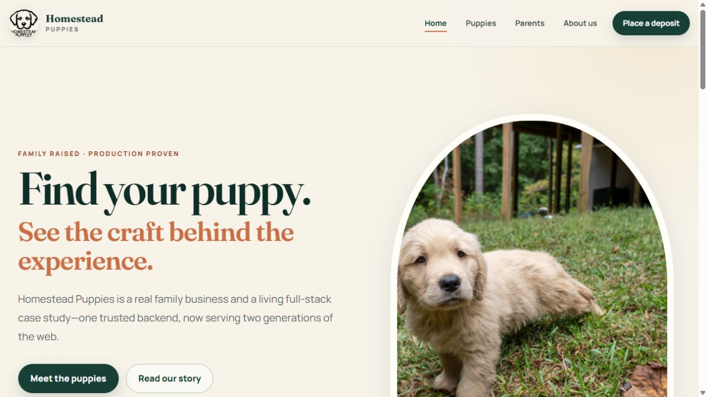
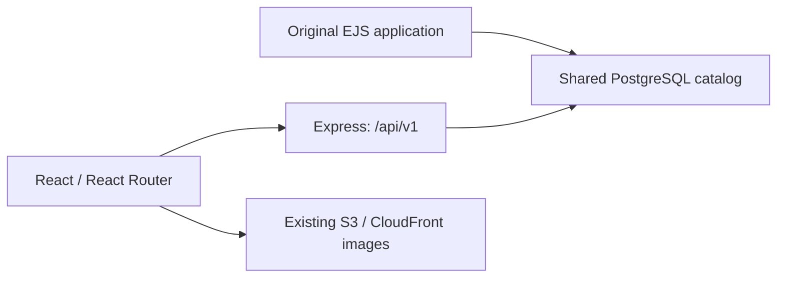

# Homestead Puppies — Modern Frontend

A React and TypeScript frontend that modernizes an existing family-business website while keeping its Express backend, PostgreSQL catalog, and administration workflow in place. This frontend uses a versioned, read-only API backed by the same catalog as the original EJS site.

[Live React site](https://homesteadpuppies.org/) · [Original EJS site](https://homestead-puppies.com/) · [Backend source](https://github.com/apelpapa/HomesteadPuppies)

## What this project demonstrates

- Incremental modernization: a new frontend around an existing application and data model.
- Typed API access and shared catalog data for puppy and parent listings.
- Responsive layouts, image carousels, and loading/error states.
- Client routing with React Router and a static production build.
- Nginx deployment with an explicit Content Security Policy and a build-time hash verification script.

The original application continues to own admin authentication, database writes, and image uploads. This repository provides the public frontend; its deposit page embeds the existing PayPal hosted payment button.

## Architecture

## Stack

- React 19, React Router 8, and TypeScript in strict mode.
- Vite 8 and Tailwind CSS 4.
- Static output served by Nginx.
- Existing Express/PostgreSQL backend and S3/CloudFront media pipeline.

## Repository map

| Path | Purpose |
| --- | --- |
| `app/` | Routes, components, styles, catalog loading, and shared types |
| `ops/nginx/homesteadpuppies.org.conf` | Static hosting, API proxy, and response headers |
| `ops/renewal-hooks/reload-nginx` | TLS renewal hook |
| `scripts/verify-csp-hashes.mjs` | Verify generated inline scripts against the configured CSP |
